<div align="center">
  </img>
</div>

# JA<sup>xtar</sup>: GPU-accelerated Batched parallel A\* & Q\* solver in pure JAX!

JA<sup>xtar</sup> is a JAX-native implementation of parallelizable A\* & Q\* solvers for neural heuristic search research, inspired by Google DeepMind's [mctx](https://github.com/google-deepmind/mctx).

Supported search algorithms:
- **A\***: Standard A* Search
- **A\* Deferred**: A* Search with deferred node expansion (for heavy expansion costs)
- **Bi-A\***: Bidirectional A* Search
- **Bi-A\* Deferred**: Bidirectional A* Search with deferred node expansion
- **ID-A\***: Iterative Deepening A* Search
- **Beam Search**: Standard Beam Search
- **Q\***: Q* Search (A* with learned Q-values)
- **Bi-Q\***: Bidirectional Q* Search
- **ID-Q\***: Iterative Deepening Q* Search
- **Q-Beam**: Beam Search with learned Q-values

## Architecture Rationale

Evaluating single nodes with neural networks on a GPU spends 50%–80% of runtime in CPU–GPU data transfers, so solvers such as [DeepCubeA](https://github.com/forestagostinelli/DeepCubeA) and [Q\*](https://arxiv.org/abs/2102.04518) batch evaluations. Keeping only network inference on the GPU still leaves host-device round trips on every expansion; running the entire search loop on-device avoids that bottleneck. Existing GPU implementations are typically written in C/CUDA (awkward for ML research), restricted to 2D grids or dense adjacency matrices that cannot scale to large state spaces, or coupled to a single domain.

JA<sup>xtar</sup> avoids those constraints through:
- **Pure JAX JIT-compiled search**: Keeps search loops, neural evaluation, and training composable in Python/JAX.
- **JAX-native priority queue and hash table**: Uses [`Xtructure`](https://github.com/tinker495/Xtructure) (`BGPQ` and `HashTable`) instead of non-JIT Python heaps or dense state matrices, enabling batched push/pop, open/closed tracking, and parent retrieval for arbitrary hashable state spaces.
- **Fully batched operations**: Expands, hashes, and evaluates batches in parallel to saturate GPU cores.
- **Puzzle-agnostic interface**: Uses [`PuXle`](https://github.com/tinker495/PuXle) for parallelized puzzle environments and trained world models, decoupling search algorithms from domain definitions.
- **Integrated neural guidance**: Connects neural heuristics, Q-functions, and latent-space world models directly into JIT-compiled search.

## Installation

Add JAxtar directly from GitHub to another uv project:

```bash
uv add "jaxtar @ git+https://github.com/tinker495/JAxtar.git"
```

For development or to use the checkout-only CLI, clone the repository and sync its environment:

```bash
git clone https://github.com/tinker495/JAxtar.git
cd JAxtar
uv sync --extra gpu
```

JAxtar uses `pyproject.toml` for installation and command registration. PuXle and Xtructure Git dependencies track their `main` branches; `uv.lock` records the resolved commits. From the synced checkout:

```bash
uv run jaxtar --help
uv run jaxtar test --help
uv run astar_d --help
```

The console commands are checkout-only. External distributions intentionally contain only the `JAxtar` core package; generic top-level modules such as `cli`, `config`, and `helpers` are not packaged.

Omit `--extra gpu` for CPU-only use, or replace it with `--extra tpu` on TPU. Evaluation tools are installed by default. The `train` extra adds the GPU runtime and all logging backends, so it conflicts with `tpu`.

## Usage and Documentation

The CLI uses **tyro** with typed options. Flat flags, short aliases, and `10M` / `2^20` numeric notation are supported. Both `--batch-size` and `--batch_size` work. Use `--help` for help; `-h` retains its `--hard` meaning. Omitted options inherit puzzle and training preset defaults.

[**Go to Documentation**](./docs/README.md) · [**Benchmark Results**](./docs/benchmark_results.md)

## Puzzles

### Target available puzzle

| Rubikscube                                              | Slidepuzzle                                               | Lightsout                                             | Sokoban                                          |
| ------------------------------------------------------- | --------------------------------------------------------- | ----------------------------------------------------- | ------------------------------------------------ |
| 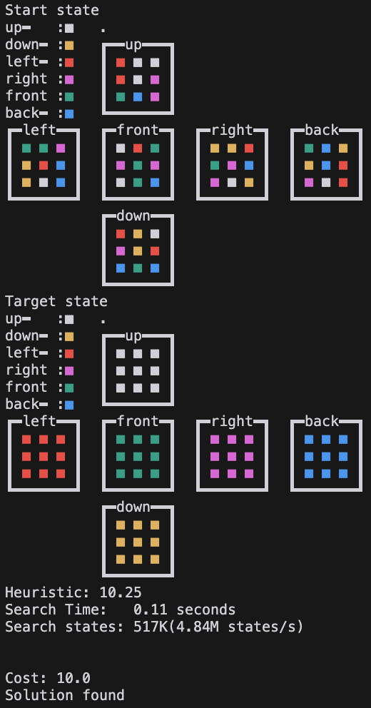        | 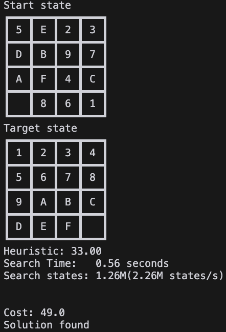        | 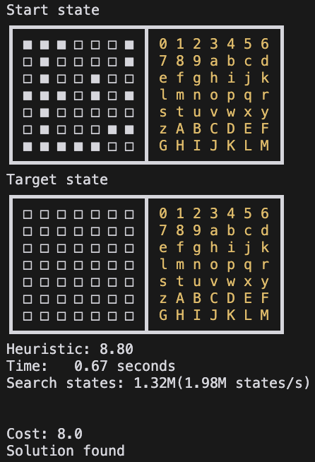        | 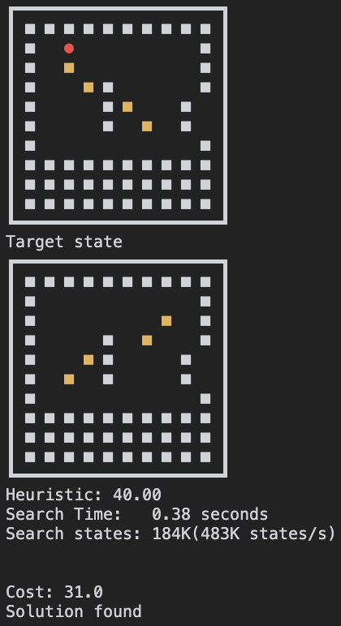        |
| 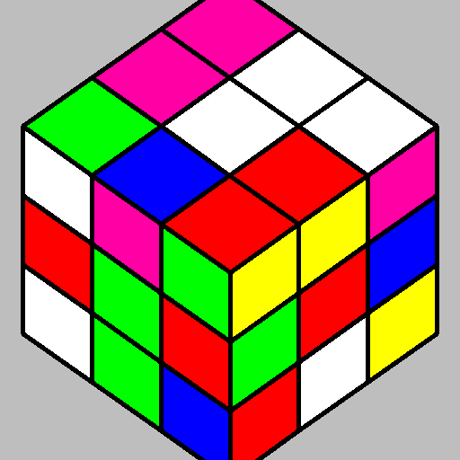 | 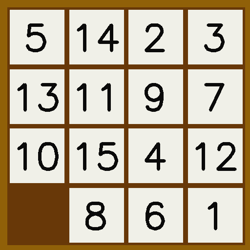 | 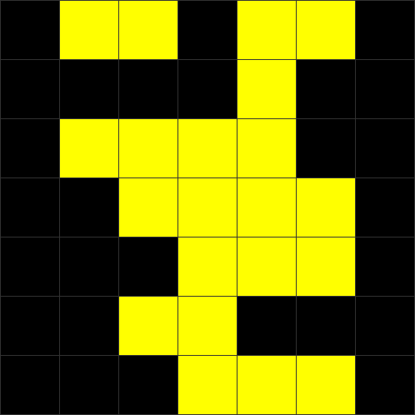 | 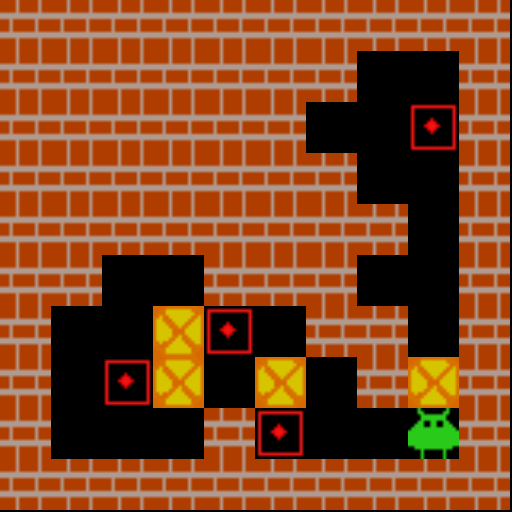 |

| Maze                                       | Pancake Sorting                                          | Hanoi                                        | TopSpin                                   |
| ------------------------------------------ | -------------------------------------------------------- | -------------------------------------------- | ----------------------------------------- |
| 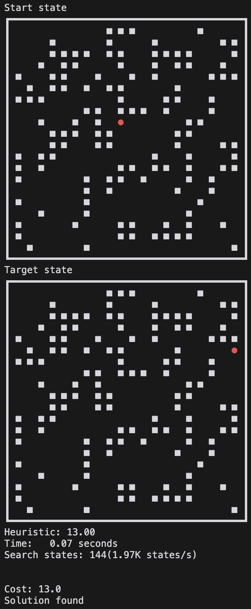        | 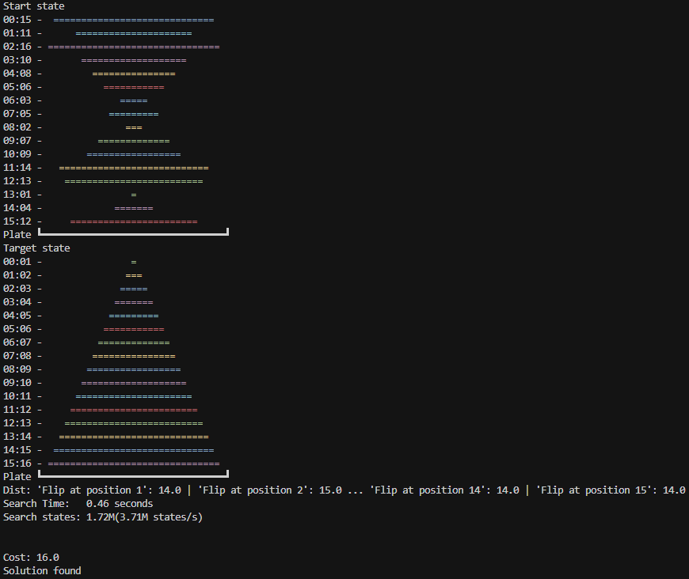        | 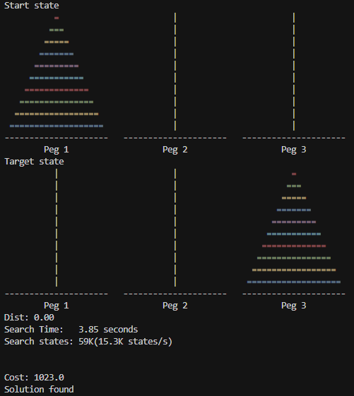        | 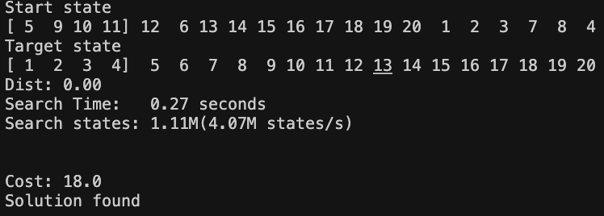 |
| 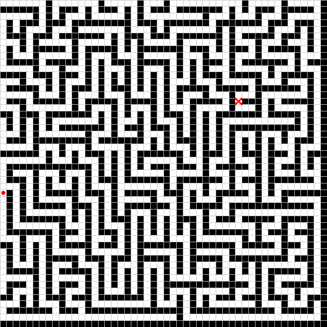 | 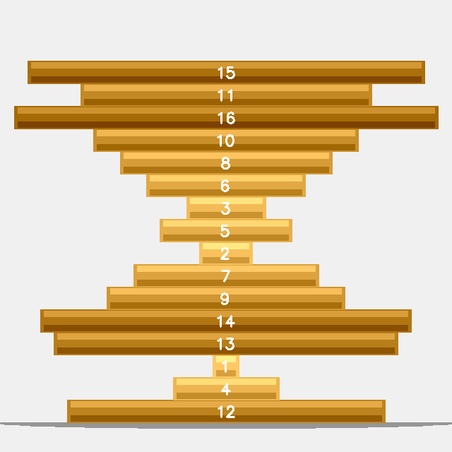 | 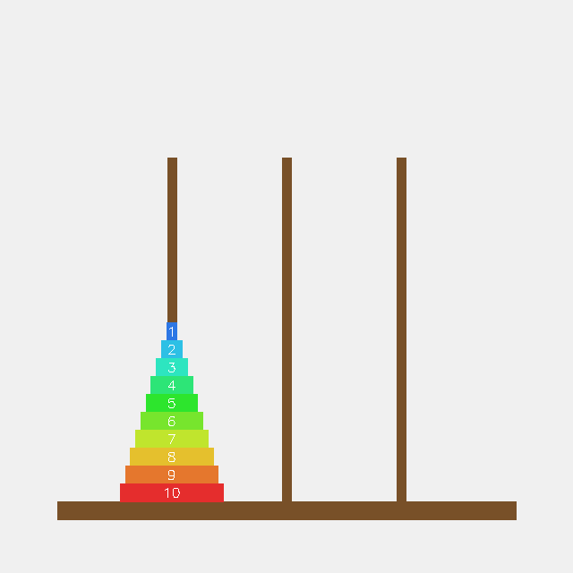 | 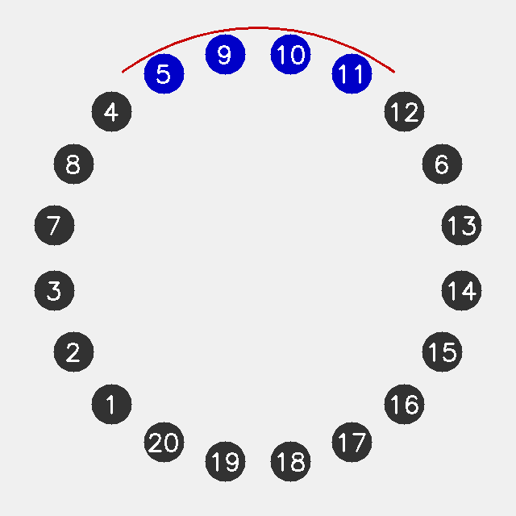 |

### Target not available puzzle

Puzzles without an explicit goal state (such as Dotknot or combinatorial optimization formulations like TSP) can also be solved with A\*/Q\* when paired with an appropriate state formulation and learned heuristic.

| Dotknot                                          | TSP                                      |
| ------------------------------------------------ | ---------------------------------------- |
| 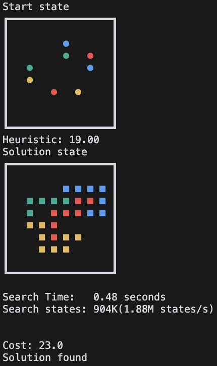        | 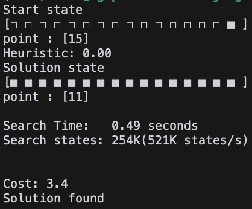        |
| 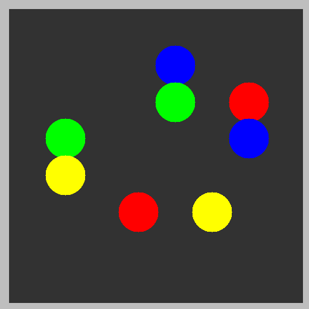 | 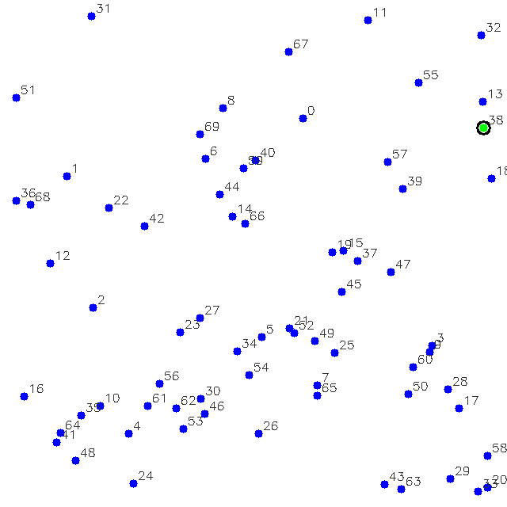 |

### World Model Puzzle

World-model implementation and training APIs live in PuXle. JAxtar registers those trained models to perform A\* & Q\* search in learned latent spaces, following ["Learning Discrete World Models for Heuristic Search"](https://rlj.cs.umass.edu/2024/papers/RLJ_RLC_2024_225.pdf).

| Terminal View                                | Rubiks Cube                                                | Rubiks Cube Reversed                                             | Sokoban                                             |
| -------------------------------------------- | ---------------------------------------------------------- | ---------------------------------------------------------------- | --------------------------------------------------- |
| 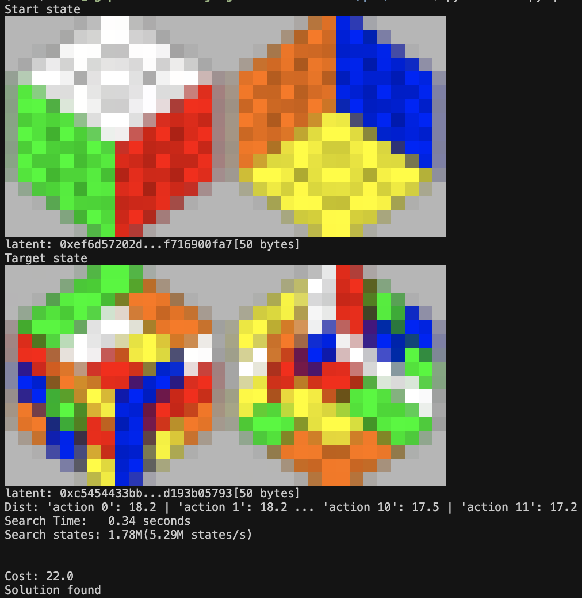 | 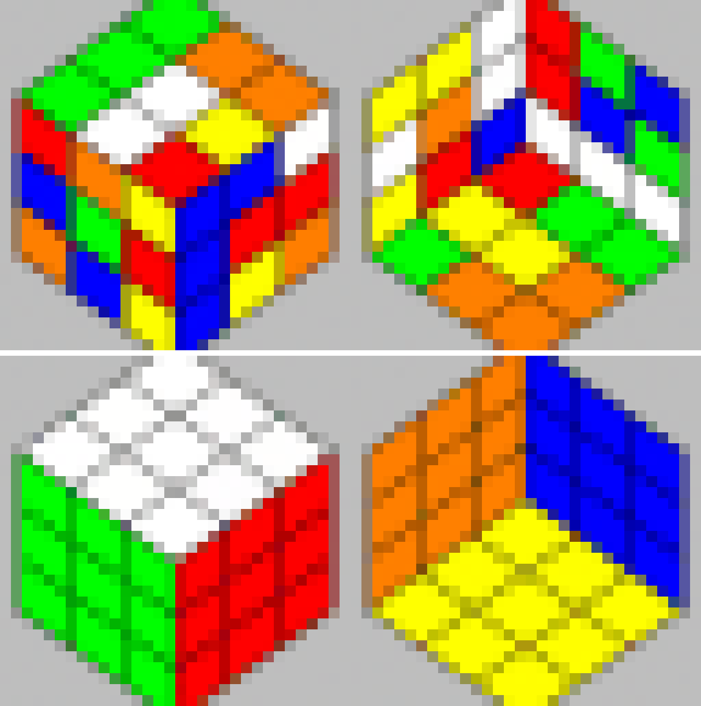 | 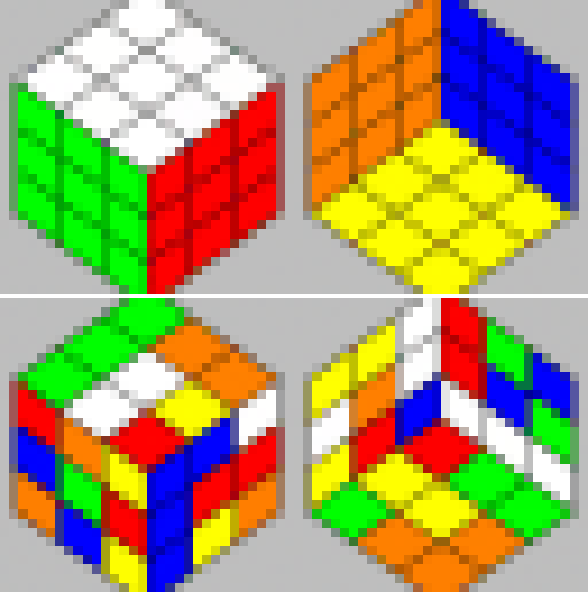 | 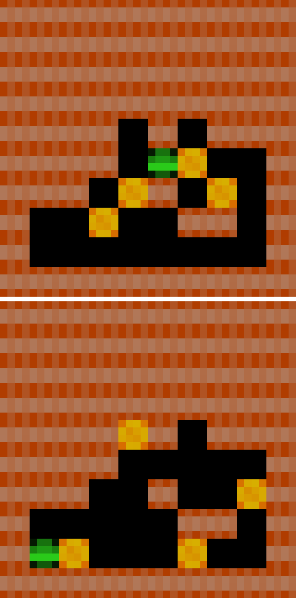 |

## Citation

Please use this citation to reference this project.

```bibtex
@software{kyuseokjung2024jaxtar,
  title = {JA^{xtar}: GPU-accelerated Batched parallel A* & Q* solver in pure JAX!},
  author = {Kyuseok Jung},
  url = {https://github.com/tinker495/JAxtar},
  year = {2024},
}
```
